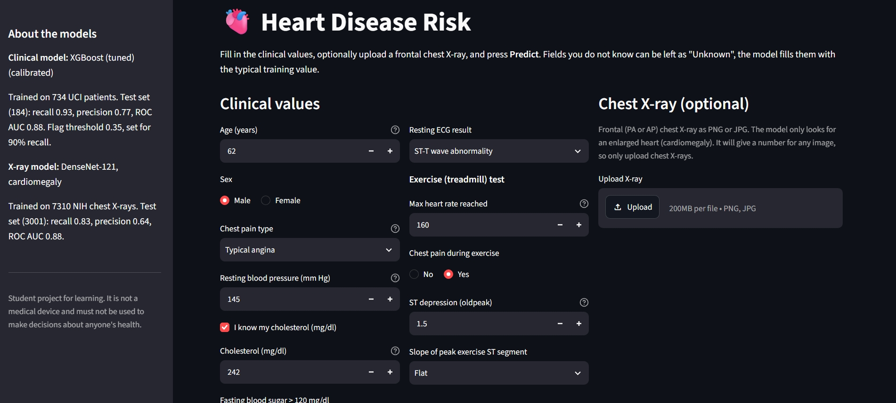
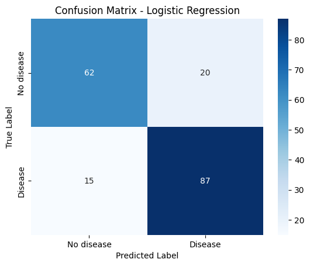
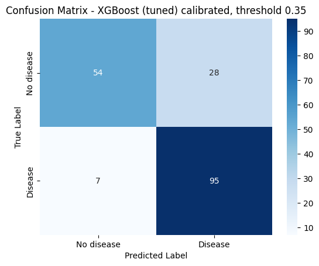
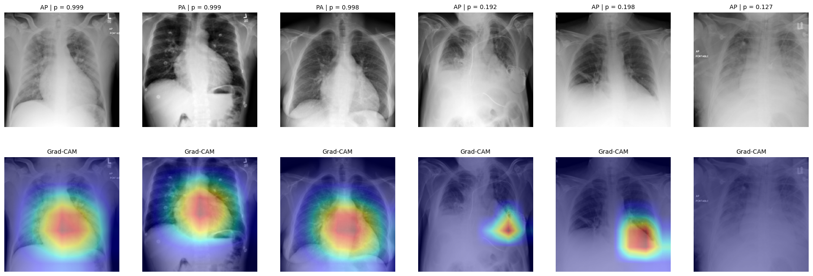
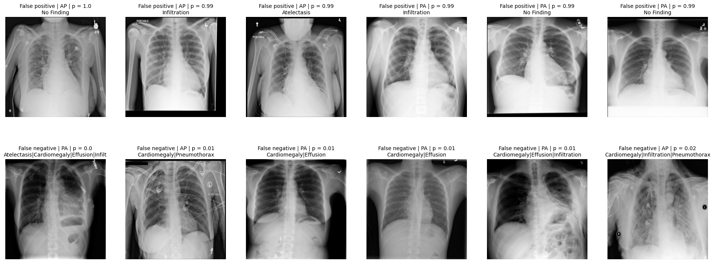

# Heart Disease Prediction: Clinical Data + Chest X-ray

Two models and a Streamlit app:
- A **clinical risk model** trained on the UCI Heart Disease data (4 hospitals, 918 patients). Logistic regression baseline, then Random Forest and XGBoost, picked by cross validation, calibrated, threshold tuned for recall.
- A **chest X-ray model**: DenseNet-121 fine-tuned in PyTorch to detect **cardiomegaly** (enlarged heart) on NIH ChestX-ray14, with a patient-wise split and Grad-CAM.




> Student project for learning. It is not a medical device and must not be used for decisions about anyone's health.

---

## Results

### Clinical model (UCI, test set of 184 patients)

| Model | CV ROC AUC (train) | Test ROC AUC | Recall | Precision | Missed sick patients |
|---|---|---|---|---|---|
| Logistic Regression (baseline), threshold 0.5 | 0.875 | 0.875 | 0.853 | 0.813 | 15 |
| Random Forest (tuned), threshold 0.5 | 0.877 | 0.875 | 0.863 | 0.793 | 14 |
| XGBoost (tuned), threshold 0.5 | 0.878 | 0.885 | 0.882 | 0.804 | 12 |
| **XGBoost, calibrated, threshold 0.35 (final)** | | **0.880** | **0.931** | 0.772 | **7** |

The threshold was chosen on out-of-fold predictions of the training set for at least 90% recall. Compared with the baseline, the final model misses **7 sick patients instead of 15**, at the cost of 8 more false alarms. Accuracy stays at 0.81.

| Baseline (logistic regression, 0.5) | Final (XGBoost calibrated, 0.35) |
|---|---|
|  |  |

### Chest X-ray model (NIH ChestX-ray14, official patient-wise test list, 3,001 images)

| Metric | Value |
|---|---|
| **Test ROC AUC** | **0.880** (95% CI 0.858 - 0.898, resampling patients) |
| ROC AUC, PA / AP views | 0.925 / 0.846 |
| Recall at threshold 0.45 (chosen on validation for 90%) | 0.825 (95% CI 0.779 - 0.862) |
| Recall, PA / AP | 0.904 / 0.773 |
| False positive rate, "No Finding" / other findings | 0.255 / 0.262 |
| Precision: this test set (36% positive) / estimated at 2.5% prevalence | 0.638 / 0.075 |
| CPU latency, mean / p95 | 127 ms / 153 ms |

| Grad-CAM: confident detections (left 3) and misses (right 3) |
|---|
|  |

All numbers, with the per-hospital and per-view tables: [RESULTS.md](RESULTS.md).

---

## What I checked (and what it showed)

**Clinical model**
- **The models are tied.** Cross-validation AUC was 0.875 to 0.878 for all of them, so the problem is close to linear and the ceiling comes from the 11 features, not the model.
- **The hospital is leakage.** 94% of Swiss patients are sick against 46% in Cleveland. Using the hospital (or a "cholesterol missing" flag, which is the same thing for Switzerland) would let the model learn where the patient was treated. Not used.
- **Why papers report 88 - 90%.** They use `ca` and `thal`, which come from fluoroscopy and a thallium scan. A user can't know them, so the app doesn't ask. The popular Kaggle `heart.csv` (1,025 rows) is the Cleveland data copied about 3 times, which is where 98-100% "accuracy" comes from. This project uses the original UCI files.
- **Calibration.** The Brier score went from 0.1332 to 0.1353, so the XGBoost probabilities were already close to calibrated.

**Chest X-ray model**
- **Patient-wise split.** The official NIH test list is split by patient, and the validation set is split by patient too. Otherwise the same heart ends up in train and test.
- **No horizontal flip.** The heart is on the left, and a flipped X-ray is a different anatomy.
- **Negatives include other findings**, so the model can't just learn "abnormal X-ray = cardiomegaly". The false positive rate is the same on normal X-rays and on X-rays with other findings (0.255 vs 0.262).
- **AP films are harder.** The heart is magnified on AP films and its border is often hidden. It isn't a shortcut, because cardiomegaly is about equally common in both views.
- **The threshold didn't transfer.** Recall was 0.917 on validation and 0.825 on test. About 3 of the 9 points come from the test set having more AP films (58% against 33%). The other 6 come from an optimistic, small validation set that was used to choose both the epoch and the threshold.
- **Precision at real prevalence.** Only ~2.5% of NIH X-rays show cardiomegaly. At that rate the same model would give about 12 false alarms per true find, so it works as a triage score, not a diagnosis.
- **The most confident mistakes** have scores of 0.99+ (false positives) and 0.02 or lower (false negatives). Several look like label problems: the NIH labels come from text mining of the radiology reports. 64% of the missed cases also have effusion, against 38% of the detected ones.



---

## How the app combines the two models

The UCI patients and the NIH X-ray patients are different people. No public dataset has both for the same patient, so the weight of each model in a combined score can't be learnt or validated. The app shows both results side by side and gives a three-level answer:

| Clinical model | X-ray model | App says |
|---|---|---|
| above threshold | above threshold | **Higher concern** |
| one above, one below | | **Moderate concern** |
| below threshold | below threshold | **Low concern** |
| X-ray not uploaded | | flagged / not flagged, noting that there is no second check |

Both thresholds are set to catch about 90% of sick patients, so each model alone also flags many healthy people. A plain "either model flags" rule would flag roughly half of healthy users when both models are used.

A real fusion model would need paired data, for example MIMIC-IV with MIMIC-CXR on PhysioNet (credentialed access).

---

## Repository

```
heart-disease-prediction/
├── README.md
├── RESULTS.md                 all numbers, one place
├── notebooks/
│   ├── HeartDisease_Part1_Clinical.ipynb    UCI, LR -> RF -> XGBoost, calibration, threshold
│   └── HeartDisease_Part2_ChestXray.ipynb   NIH, DenseNet-121, Grad-CAM, error analysis
├── app/
│   ├── app.py
│   ├── requirements.txt
│   └── artifacts/             model files go here (see artifacts/README.md)
└── assets/                    figures used in this README
```

## Run it

**Notebooks:** Google Colab.
- Part 1 runs on CPU in about 5 minutes.
- Part 2 needs a T4 GPU and a Kaggle API key. The 42 GB NIH download is read straight from the zip, about 11k images are resized to 256 px and cached in Google Drive, and training takes about 30 minutes.

**App:**
```bash
cd app
pip install -r requirements.txt
streamlit run app.py
```
Put the 4 model files from the notebooks' Drive folder into `app/artifacts/` first.

## Limitations

- UCI data is from the 1980s, 4 hospitals, 918 patients. A real model would need validation on current patients from the hospital where it runs.
- NIH labels come from NLP on radiology reports, so they are noisy. The true accuracy against a radiologist is unknown. VinDr-CXR (radiologist labels) is the next external test.
- The X-ray scores are not calibrated probabilities (many are close to 0 or 1).
- The X-ray model gives a score for any image. It doesn't check that the upload is a chest X-ray.
- The two models are not fused (see above).

## Data

- **UCI Heart Disease**: Janosi, Steinbrunn, Pfisterer, Detrano (1988). UCI Machine Learning Repository, https://archive.ics.uci.edu/dataset/45/heart+disease
- **NIH ChestX-ray14**: Wang et al., *ChestX-ray8*, CVPR 2017. NIH Clinical Center, via Kaggle `nih-chest-xrays/data` (CC0). The example images in `assets/` come from this dataset.
- DenseNet-121 ImageNet weights: torchvision.
